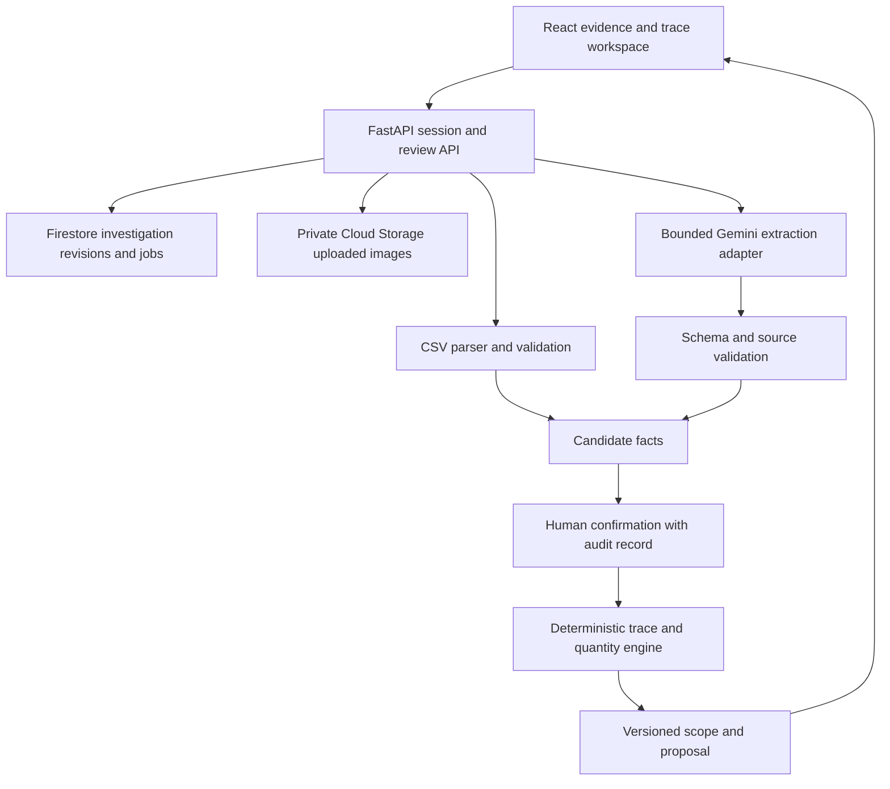

# BatchLens Build Ready Project Plan

Version 1 • 15 October 2026 • All times Singapore time UTC+8

BatchLens helps a quality manager turn scattered complaint, supplier, production, and shipping records into an evidence-backed inspection scope. The hackathon prototype follows one fictional bottle manufacturer from a leaking-product complaint to a reviewed proposal identifying shipments that share a suspect component lot.

**Pitch:** One defective product. Which shipments need checking? Trace every answer back to evidence.

**Theme:** Manufacturing: Intelligent Operations & Industrial Efficiency.

**Delivery target:** working deployment on 16 October; feature freeze at noon on 17 October; submission package ready by 20:00 on 17 October. Treat 18 October as submission buffer. The exact submission cutoff remains unconfirmed; bring these milestones forward if the dashboard requires it.

**Current status:** project selected and plan prepared. Application implementation, model access, deployment, evaluation, and submission are upcoming work.

## 1 Product and value

The primary user is a quality manager at a small manufacturer who receives a complaint and must establish which other shipments warrant inspection. The immediate job is to connect records, identify gaps, and document a defensible scope for human review.

The product hypothesis is that source-linked extraction and traceability can reduce investigation effort while preserving visibility into missing records. Measure this through scope accuracy and task completion time. Do not equate shared component exposure with a confirmed defect, or fixture-based calculations with proven savings.

BatchLens focuses on evidence assembly and inspection scoping. It does not certify product safety, establish a physical root cause, release stock, or execute a recall. Every final artifact is labeled “Inspection proposal — requires quality review.”

The potential buyer is a manufacturing quality or operations lead. Buyer willingness, production integration requirements, and commercial value require interviews after the prototype.

## 2 Competitive position and judging strategy

Lot traceability and manufacturing quality investigation already exist in established systems, including Siemens offerings. The proposed distinction is a compact workflow for fragmented documents: extract candidate facts, review their sources, trace confirmed relationships, expose uncertainty, and update the scope when new evidence arrives. This is a differentiation hypothesis, not a claim of category invention.

The official rubric assigns technical merit and GenAI implementation 40%, problem alignment and impact 25%, innovation 25%, and user experience 10% [S1]. Demonstrate each through a concrete artifact:

| Criterion | Evidence in the submission |
| --- | --- |
| Technical and GenAI | Live Gemini extraction from a label/report, validated candidates, deterministic graph traversal, persisted investigation |
| Impact | Correct scope on a reference case; measured investigation time if participants are available |
| Innovation | An unresolved record visibly changes the decision; a new document updates the trace with full provenance |
| UX | Three clear screens, one-click source inspection, readable graph and equivalent table, transparent progress |

The most important visual is the investigation graph changing after evidence is confirmed. Prioritize this over decorative animation, voice, or an open-ended chatbot.

## 3 MVP scope

### Required capabilities

1. Start a fresh investigation using the bundled synthetic bottle case.
2. View six initial artifacts and their extraction/import status.
3. Run real Gemini extraction on the complaint label and supplier report; import structured CSV records with deterministic parsing.
4. Review candidate identifiers and relationships beside the source. Accept, reject, or correct them with an audit record.
5. Select a suspect component lot using the complaint trace and inspection report as evidence.
6. Compute confirmed exposure paths through component lot → finished batch → shipment.
7. Show three mutually exclusive shipment categories: included, unresolved, and no recorded connection within this case.
8. Add a supplied clearer packing slip, review its extracted batch identifier, and recompute the scope.
9. Generate and download a source-linked inspection proposal as HTML and CSV.
10. Resume after refresh; reset into a new investigation; preserve revisions and reviewer actions.

The initial public release supports the curated case and one bounded supplementary PNG/JPEG document upload. General document ingestion, arbitrary PDFs, and arbitrary business schemas are outside the deadline. The six curated artifacts can include PDF and text previews because they are authored and validated in advance.

### Optional only after release gates pass

- A compact before/after scope comparison.
- One bounded “Explain this inclusion” Gemini action using confirmed facts only.
- A second altered fixture for evaluation, without adding it as a selectable product scenario.

### Excluded

ERP/MES connectors, live factory telemetry, automated defect detection from product appearance, causal diagnosis, email sending, supplier outreach, inventory release, automated recalls, geographic routing, voice, team accounts, multiple organizations, vector databases, and multiagent orchestration.

## 4 Authored case and exact reference outcome

The fictional manufacturer is **Northstar Bottles**. A customer reports leaking caps on a reusable bottle. A label identifies batch B101. A supplier report records an out-of-tolerance dimensional inspection for cap lot CAP-17. That supports treating CAP-17 as suspect for this investigation; it does not prove the cause of the customer's leak.

### Evidence bundle

| ID | Artifact | Contents and purpose |
| --- | --- | --- |
| E1 | complaint.txt | Complaint, product family, reported symptom; no claim of confirmed root cause |
| E2 | label.jpg | Original staged label photo showing B101; Gemini extracts the batch identifier |
| E3 | supplier-inspection.pdf | One-page authored report identifying CAP-17 and an inspection exception; Gemini extracts cited fields |
| E4 | production.csv | B101, B102, B104 use CAP-17; B103 uses CAP-18; component quantities are unnecessary for v1 |
| E5 | shipments.csv | Four shipment records and quantities below; S4 has no confirmed batch ID |
| E6 | packing-slip-blurred.jpg | S4 identity and quantity are readable, but batch text is obscured; expected batch result is null |
| E7 | packing-slip-clear.jpg | Supplementary document identifies S4 → B104; added during the live demonstration |

Create original assets during the build. Never encode the obscured batch answer in E6's filename, metadata, alternative text, or model prompt. Keep reference answers in test fixtures, outside the public bundle and extraction context.

### Shipment universe

| Shipment | Confirmed batch initially | Units | Reference category before E7 | After E7 is confirmed |
| --- | --- | ---: | --- | --- |
| S1 | B101 | 600 | Included | Included |
| S2 | B102 | 400 | Included | Included |
| S3 | B103 | 500 | No recorded connection | No recorded connection |
| S4 | Unknown | 500 | Unresolved | Included via B104 |
| Total | | 2000 | | |

Before E7: **1000 included, 500 unresolved, 500 with no recorded connection**. After E7: **1500 included, 0 unresolved, 500 with no recorded connection**. B104 is already connected to CAP-17 before E7, but initially has no confirmed shipment edge.

For a conservative inspection proposal, include both connected and unresolved shipments: 1500 units before and after E7. The new evidence changes certainty and supporting paths; it does not manufacture a reduction in workload. Compared with inspecting all 2000 shipped units, the scoped proposal covers 500 fewer units, or 25%, within this authored case. This is a scope calculation, not measured savings or a safety recommendation.

Do not sum the same units again at the batch or component level. Shipment line IDs are the counting unit. V1 uses one batch per shipment line; split shipments require separate line IDs.

## 5 Traceability and uncertainty rules

Use a directed graph with typed nodes: component_lot, finished_batch, shipment_line. Evidence citations attach to facts and edges, not only to an investigation summary.

For each shipment line:

1. Mark **included** if there is a complete confirmed path from the selected suspect lot to that line.
2. Otherwise mark **unresolved** if its batch mapping is missing, its component lineage is incomplete, or a relevant relationship is in conflict.
3. Otherwise mark **no recorded connection** only when complete confirmed lineage within the case establishes that it uses other component lots.

An included path remains included if additional uncertainty exists; show the uncertainty as a separate flag. A conflict affecting the only alleged path prevents that path from being treated as confirmed. No recorded connection means only that the available complete case records do not connect it to the selected lot; never label this category “safe.”

Identifier normalization may trim whitespace and apply an explicit case policy. Do not silently replace visually similar characters such as O/0 or I/1. Fuzzy matches remain candidates requiring review.

Conflicting sources never resolve by newest upload alone. Preserve both claims and require an explicit review resolution with a reason. Superseding an accepted edge increments the investigation revision and invalidates derived scopes and unsnapshotted proposals.

Reject negative quantities, duplicate line IDs, unknown units, malformed required columns, invalid node types, and impossible edge directions. Duplicate file hashes may reference an existing artifact but cannot duplicate facts or counts.

The scope engine is a pure function of confirmed facts, selected suspect lots, case completeness rules, and engine version. It has no Gemini dependency and produces the same output for the same inputs.

## 6 Interface and standout demo

### Evidence screen

Show the complaint at the top and a document list with statuses: ready, extracting, needs review, confirmed, failed. Selecting an artifact opens its preview beside candidate fields. Each field shows the raw extracted value, normalized value, page or row reference, and accept/correct/reject controls.

Show factual progress such as “Reading supplier report” and “Validating identifiers.” Do not animate fabricated agent thoughts. The first screen states that the case is synthetic and uploaded images are processed by Google for extraction.

### Trace screen

Use a fixed left-to-right layout: component lots, batches, shipments. Solid edges mean confirmed relationships; dashed edges mean candidates. Use color plus icons and text so categories remain understandable without color. Keep uncertain shipments in a visible lane instead of hiding them.

Clicking any node or edge opens its source drawer. The shipment table mirrors the graph for keyboard and narrow-screen use. Display included and unresolved quantities separately, with the case total always visible.

### Decision screen

Show the selected suspect lot, conservative inspection scope, unresolved records, included shipment rows, and the exact evidence path behind each row. Let the user snapshot a proposal with a reviewer note. The saved proposal records its revision and creation time and remains immutable after later evidence changes.

### Three minute master storyboard

| Time | Action | Point demonstrated |
| --- | --- | --- |
| 0:00–0:20 | Open complaint and leaking-bottle illustration/photo | A concrete quality problem anyone can understand |
| 0:20–0:50 | Extract label/report fields and confirm cited candidates | Real multimodal Gemini use with review |
| 0:50–1:20 | Open graph; select CAP-17; inspect one inclusion path | Records become an explainable scope |
| 1:20–1:40 | Select S4 and its obscured packing slip | Missing evidence remains unresolved |
| 1:40–2:10 | Add clear slip, confirm B104, watch S4 become included | New evidence changes the decision transparently |
| 2:10–2:35 | Open and download inspection proposal | A complete usable output |
| 2:35–3:00 | Show architecture and actual test results | Technical credibility and honest impact |

Prepare a 2:50 cut and a separate extension for a longer permitted video. The prior brief records conflicting website and organizer-email duration guidance; confirm the dashboard/current organizer requirement before final export. Do not assume the storyboard resolves it.

Live extraction latency may exceed the segment allocation. In recorded video, label any time compression. Maintain a separately labeled recorded walkthrough as backup; never present saved model output as a new live response.

## 7 Architecture

Use React, TypeScript, and Vite for the UI; Python, FastAPI, and Pydantic for the API; the Google GenAI Python SDK for model calls; Firestore for bounded investigation records; private Cloud Storage for uploaded images; and a single Cloud Run service serving both API and compiled frontend.

For this small graph, use SVG with fixed columns and accessible HTML controls. Native fetch and simple React state are sufficient. Avoid a graph database, vector retrieval, background-worker platform, and a large component framework.



### Model responsibility

Gemini extracts identifiers and report observations from bounded artifacts and returns structured candidates with citations. Structured output supports predictable schema-shaped responses, but schema compliance does not establish factual accuracy [S2]. Validate values and sources before showing candidates, then require review before graph commitment.

Keep `MODEL_ID` configurable. Select a currently available Flash-class Gemini model that supports image/PDF input and structured output in the approved Google Cloud project. Confirm model availability, authentication, region, quota, latency, and price with one real smoke test. Pin SDK and dependency versions after that test; do not copy an untested model identifier from the earlier IncidentLab brief.

No arbitrary model tools are required. Gemini cannot modify graph state, confirm facts, compute final scope, or invoke actions. Use an authored deterministic explanation when extraction is unavailable, clearly labeled as such; do not substitute hidden reference answers as live extraction.

### Hosting and persistence

Build frontend assets in a Docker stage and serve them from FastAPI. Bind to `0.0.0.0` using the Cloud Run `PORT` environment variable [S3]. Use same-origin API calls. Package immutable synthetic assets with the application; persist all mutable state outside the container.

Store metadata and facts in Firestore subcollections rather than an ever-growing single document. Store uploads under server-generated private object keys. Source previews are served through ownership-checked routes. Do not expose the Firestore database or storage bucket to browser writes.

Use a dedicated service identity with only necessary model, Firestore, and bucket permissions. Set minimum instances to zero and maximum instances initially to two. A local storage adapter is for development; the deployed acceptance tests must use the actual persistent services.

## 8 Core data contracts

All timestamps use UTC internally and display in the user's chosen timezone. All mutable records carry a schema version. Pydantic rejects unknown request fields and invalid enums; generate the frontend API types from OpenAPI.

| Record | Required fields |
| --- | --- |
| Investigation | id, scenario_version, revision, status, suspect_lot_ids, created_at, expires_at; private owner_token_hash |
| Artifact | id, investigation_id, hash, media_type, storage_key or bundled_asset_id, size, extraction_status, created_at |
| Citation | artifact_id, page or row, field_name, source_excerpt; optional validated image region |
| Candidate fact | id, subject, predicate, proposed_value, raw_value, citations, extractor_version, model_id, status |
| Review decision | id, candidate_id, accept/reject/correct, corrected_value if applicable, reason, request_id, revision |
| Confirmed edge | id, from_node, to_node, edge_type, citation_ids, review_id, active_revision |
| Shipment line | id, shipment_id, units, unit_type, confirmed_batch_id or null, completeness_flags |
| Scope | revision, engine_version, suspect_lot_ids, per_line_category, path_edge_ids, unresolved_reasons, totals |
| Extraction job | id, artifact_id, status, lease_expires_at, attempt_count, model_id, input_hash, error_code, usage |
| Proposal | id, investigation_revision, engine_version, frozen_scope, citation_snapshot, reviewer_note, created_at |

Do not display model-generated confidence percentages as calibrated probabilities. Use observable states such as needs review, unreadable, source conflict, and confirmed.

For text/PDF candidates, verify that cited excerpts and locations correspond to available source content where machine-verifiable. For image text, show the source image for human confirmation; a model-proposed bounding box or transcription is not independently verified evidence.

## 9 API and state consistency

| Endpoint | Purpose |
| --- | --- |
| POST /api/investigations | Create fresh synthetic case and ownership cookie |
| GET /api/investigations/{id} | Get public state, revision, artifact statuses, and scope |
| GET /api/investigations/{id}/artifacts/{artifact_id} | Authorized source preview |
| POST /api/investigations/{id}/artifacts | Upload one bounded supplementary image |
| POST /api/investigations/{id}/extractions | Reserve and run a bounded extraction request |
| GET /api/investigations/{id}/extractions/{job_id} | Read extraction status and candidates |
| POST /api/investigations/{id}/reviews | Accept, reject, correct, or resolve conflicting candidates |
| POST /api/investigations/{id}/suspect-lots | Set reviewed investigation hypothesis |
| GET /api/investigations/{id}/scope | Read deterministic scope at current revision |
| POST /api/investigations/{id}/proposals | Snapshot a reviewed inspection proposal |
| GET /api/investigations/{id}/proposals/{proposal_id}/export | Download HTML or CSV |
| DELETE /api/investigations/{id} | Delete or mark investigation for cleanup; deny further access immediately |
| GET /api/health | Lightweight health check |

State mutations use `request_id` and `expected_revision`. A Firestore transaction checks ownership, expiry, deduplication, and revision before applying a mutation. Identical repeated requests return their stored result; reusing an ID with a different payload fails. Stale revisions return 409 and refreshed state.

Never call Gemini inside a Firestore transaction because transaction functions can run more than once [S4]. Reserve a job and usage allowance transactionally, call Gemini outside the transaction, then save candidate output against the immutable artifact hash. Only confirmed review mutations change the evidence graph.

For v1, execute the model call within the extraction HTTP request using an async SDK/client and bounded timeout. A second tab can poll the job record. If the process fails, the lease expires and a retry can resume; do not rely on an in-process background task continuing after the response. A late result may only commit if it still owns the job lease.

Refresh resumes the investigation. Reset creates a new case. Existing proposals remain tied to the revision they captured; a changed investigation offers “Create updated proposal” and marks older proposals as superseded in the UI.

## 10 Extraction and import implementation

1. Validate artifact type, size, and ownership; hash accepted bytes.
2. Parse CSV using a fixed schema and preserve source row numbers.
3. Send only the selected bounded artifact and extraction schema to Gemini. Treat document instructions as untrusted content.
4. Require null for unreadable identifiers and explicit conflict markers for contradictory candidates.
5. Validate schema, identifier shape, permitted predicates, source IDs, and quantity types.
6. Show candidates beside source evidence. Do not write inferred relationships directly into confirmed state.
7. Record reviewer decisions and regenerate scope from confirmed facts.
8. Save model version, prompt version, latency, and token usage for reproducibility.

Use separate small extraction schemas for a product label, supplier inspection report, and packing slip. Do not make a universal document agent. CSV imports may use bulk confirmation after a table preview; the demo should not require dozens of clicks.

Model timeout, malformed output, invented citations, and quota exhaustion must leave the investigation usable. Show a retry option and manual source-backed entry. Manual entry is explicitly attributed to the reviewer and must not be recorded as model extraction.

## 11 Limits and data handling

Initial configurable limits: 10 artifacts per investigation, 5 MiB per supplementary image, 12 megapixels decoded image size, 8 model attempts per investigation including retries, one concurrent extraction per investigation, and 24-hour investigation expiry. Restrict initial model output to approximately 2000 tokens per artifact, with one retry for a transient failure within the same budget.

Use 30-second model deadlines as an initial target and a longer bounded API request deadline. Tune only after measuring the real deployment. Show elapsed progress and a recoverable timeout state.

Add a project-wide application admission counter with a configured daily model-call ceiling before public exposure. The exact ceiling and budget must be selected during cloud setup. Budget alerts do not stop spending; enforce application caps and service quotas as well.

Use high-entropy Secure, HttpOnly, SameSite ownership cookies; validate Origin/CSRF for mutations; escape rendered text; and enforce per-session access on every route. Allow an explicit local-development cookie setting for localhost only. Never render uploaded HTML or accept arbitrary remote URLs.

Do not log document contents, customer-like text, or ownership secrets. Record IDs, revisions, status codes, latency, usage, and error classes. Expired investigations become inaccessible immediately even if physical Firestore/bucket cleanup occurs later. Implement cleanup and state the actual retention behavior in the README.

CSV export must escape cells that could be interpreted as spreadsheet formulas. HTML export escapes all source and reviewer content. Export includes source labels and excerpts plus a link to the investigation; explain that online source links expire with the case.

## 12 Repository layout and work ownership

```text
BatchLens/
  BUILD_PLAN.md
  README.md
  frontend/src/
    api/                 # generated types and fetch client
    components/          # evidence viewer, graph, table, source drawer
    screens/             # Evidence, Trace, Decision
  backend/app/
    api/                 # ownership and request handlers
    models/              # Pydantic schemas
    imports/             # CSV parsing and normalization
    ai/                  # Gemini adapter, prompts, validators
    trace/               # pure classification and quantity functions
    storage/             # Firestore and private file adapters
    exports/             # escaped HTML and CSV
  backend/scenarios/bottles_v1/
    manifest.json
    assets/              # original evidence artifacts
  tests/
    fixtures/            # reference answers and altered cases
    unit/
    integration/
    e2e/
  docs/
    architecture.md
    evaluation.md
    provenance.md
    demo-script.md
  Dockerfile
  .env.example
  dependency lockfiles
```

Suggested two-person split: Builder A owns schemas, trace engine, API, storage, and deployment. Builder B owns original case assets, UI, source previews, demo, and submission materials. Agree contracts before splitting work; one owner edits the core trace engine. These are proposed assignments, not confirmed staffing.

For a solo build, execute the same milestones sequentially and drop optional explanations and comparison views. Do not add agents or infrastructure solely to increase apparent sophistication.

## 13 Acceptance tests and evidence

### Deterministic correctness

- Initial and final shipment categories and quantities match Section 4 exactly.
- Duplicate paths and duplicate imports do not double-count units.
- Missing batch ID stays unresolved; no match is never automatically classified outside scope.
- CAP-17 and CAP-18 remain distinct; ambiguous characters are not auto-corrected.
- An accepted path is required for inclusion; unreviewed Gemini candidates cannot alter totals.
- Conflicting lineage blocks the disputed path until resolved; replacing a fact invalidates derived results.
- Changing the suspect lot changes scope reproducibly.
- Frozen proposals keep their original counts, citations, and revision.

### Model and extraction checks

- Label and supplier report each produce at least one real, reviewed, correctly sourced extraction in the deployed environment.
- Obscured E6 returns an unreadable/null candidate or is rejected by reviewer validation; it never silently commits B104.
- Clear E7 extracts S4 and B104 with the correct source attachment.
- Invalid schemas, fabricated source IDs, embedded prompt instructions, timeouts, and exhausted budgets fail safely.
- Test an altered identifier fixture to detect reliance on memorized demo answers.

### Session and UI checks

- Refresh resumes; reset starts clean; duplicate commands cannot duplicate facts or proposals.
- Concurrent tabs receive revision conflicts instead of overwriting each other.
- Unauthorized and expired sessions fail on document previews, exports, and all API routes.
- Failed extraction and process interruption can recover after lease expiry.
- Keyboard users can inspect every graph relationship through the equivalent table.
- Narrow-screen layout, contrast, loading, empty, and failure states are usable.
- Ten fresh deployed sessions complete the curated flow without blocking errors; log failures and rerun after fixes.

Use pytest for the trace engine and API integration, Vitest for meaningful UI state logic, and Playwright for the critical browser flow. Use a fake model adapter in routine tests and a small explicitly measured set of real model checks for integration evidence.

### Evaluation protocol

Create two small equivalent cases with different IDs and mappings. If 3–5 participants are available, counterbalance which case they solve manually and which they solve with BatchLens. Record experience, time, missed included shipments, incorrectly included shipments, and unresolved-record handling. Acknowledge the small sample and possible case/learning effects.

Report actual participant counts and individual results. If no participants are available, report technical correctness and latency only, with user validation pending. A reference-case result cannot substantiate a real-world reduction in defects, waste, recall cost, or safety risk.

## 14 Execution schedule

This schedule assumes work begins on the evening of Thursday 15 October and two contributors can work on 16–17 October. Times are Singapore time. It is aggressive; the fallback rules below preserve a working core if staffing or cloud access differs.

| Time | Build work | Exit condition |
| --- | --- | --- |
| 15 Oct 21:30–22:15 | Confirm cloud project/access, repo location, owner split; inspect submission dashboard and prescribed deck template | Owners and unresolved submission rules recorded; model smoke test attempted |
| 15 Oct 22:15–23:30 | Author manifests and reference records; implement pure scope function; sketch three screens | Tests prove 1000/500/500 initial and 1500/0/500 final classification |
| 15 Oct 23:30–00:15 | Connect minimal API to table UI; add clear-slip review as a fixture-backed development action | Start → review relationship → updated scope works locally |
| 16 Oct 09:00–11:00 | Real Gemini label/report extraction; candidate review; source viewer | Live extraction enters the same confirmed-fact workflow |
| 16 Oct 11:00–13:00 | Persistent sessions, private source handling, Docker and first Cloud Run deployment | Refreshable live URL with a real Gemini extraction |
| 16 Oct 14:00–17:00 | Finish graph, supplementary-image flow, conflict handling, and proposal export | Full E1–E7 story works on deployed service |
| 16 Oct 17:00–19:00 | Idempotency, ownership, quotas, timeout recovery, original asset/provenance review | Failure paths work; no critical state-integrity issue |
| 17 Oct 09:00–12:00 | Regression and altered-fixture tests; keyboard/mobile fixes; limited user checks | Feature freeze at 12:00; core release gates pass |
| 17 Oct 12:00–15:00 | Actual result tables, README, architecture diagram, prescribed deck | Complete narrative backed by measured results |
| 17 Oct 15:00–18:00 | Record demo; verify duration rule; fix only material defects | Final video, deck, source, live URL, and description ready |
| 17 Oct 18:00–20:00 | Clean-browser review; verify public access; review submission and obtain final authorization | Submission package ready, and submit if authorized and form permits |
| 18 Oct | Buffer for submission-blocking issues and confirmed deadline | Submit with margin; keep prototype available through evaluation |

No exact October 18 hour is assumed. On first dashboard access, record the cutoff and timezone, video rule, deck template, final theme field, source visibility rule, and required service availability period. Team formation is already complete according to the previous brief; do not reopen it.

## 15 Critical path and fallback decisions

**Critical path:** coherent evidence fixture → deterministic scope → review UI → real model extraction → persistent live deployment → complete demo → submission package.

| Trigger | Required response |
| --- | --- |
| Model/cloud access unavailable on 15 Oct | Continue engine and UI with explicitly labeled fake adapter; resolve access first on 16 Oct. A fake-only submission does not meet the Google AI goal |
| No deployed real extraction by 16 Oct 13:00 | Stop optional UI work and focus on a single supported image extraction plus deployment |
| Graph interaction slows implementation | Keep the fixed-column SVG and source-linked table; omit pan/zoom and animated layout |
| Supplementary upload insecure or unstable by 16 Oct evening | Restrict it to a server-side “Add supplied clear slip” action; retain real Gemini extraction and disclose curated-input scope |
| Report PDF extraction is unreliable | Use an authored image of the same report page and retain source review; document supported formats |
| No external participants by 17 Oct morning | Run internal technical evaluation; mark user validation pending |
| Core flow fails at noon 17 Oct | Cut optional explanation and comparison features; preserve citations, uncertainty, deterministic scope, real AI, and deployment |
| Deployed model is unavailable during demo | Show the failure state honestly and use labeled recorded evidence of prior successful execution; repair before submission if possible |

Never cut ownership checks, counting correctness, uncertainty visibility, or truthful model provenance to preserve animation.

## 16 Submission package

Required deliverables from the supplied research requirements: prescribed-template pitch deck, working demo video, deployed prototype available through evaluation, accessible GitHub repository, and brief description. Google AI integration and Google Cloud hosting are also required [S1].

Map the deck into the prescribed template: user and problem; complete investigation; Gemini and deterministic architecture; uncertainty and differentiation; actual technical/user results; limitations and next validation. Do not replace the prescribed template with a newly invented layout.

README must include setup and test commands, environment variable names without secrets, deployment URL, model/provider configuration, data provenance, scope rules, synthetic-data labeling, privacy and retention, limits, known issues, and actual validation results.

Draft description:

> BatchLens helps manufacturing quality teams trace a reported defect through supplier, production, and shipping evidence. Gemini extracts source-linked facts from documents and images; reviewers confirm relationships before a deterministic engine computes an inspection scope. The prototype makes missing records visible and updates the scope when new evidence arrives, producing an auditable inspection proposal from an original synthetic case.

Before submission, verify links from a logged-out browser, remove secrets and private data, record deployed commit/revision, check dependency licenses and asset provenance, verify the final video duration, and capture final submission authorization. The current request authorizes this plan; cloud spending, account/IAM changes, public publishing, and competition submission are subsequent implementation decisions.

## 17 First build session checklist

- [ ] Confirm staffing and assign the engine/API and UI/evidence owners.
- [ ] Verify dashboard deadline, theme, deck template, video duration, and link requirements.
- [ ] Select the Google Cloud project, budget ceiling, region, and service identity.
- [ ] Make one server-side Gemini image extraction smoke test and pin working dependencies.
- [ ] Author E1–E7, manifest, and reference outcomes with consistent IDs and original assets.
- [ ] Implement and test classification before connecting model output.
- [ ] Build the smallest end-to-end flow and deploy on 16 October morning.

## 18 Sources and planning inputs

- [S1 Official themes, submission requirements, and judging rubric](https://aibuildercup.com/themes.html), checked 15 October 2026. The page contains inconsistent secondary category copy; use the main manufacturing theme and verify the submission dropdown.
- [S2 Gemini structured output documentation](https://ai.google.dev/gemini-api/docs/structured-output), checked 15 October 2026. Confirm the selected model's supported schema features during smoke testing.
- [S3 Cloud Run container contract](https://docs.cloud.google.com/run/docs/container-contract), checked 15 October 2026.
- [S4 Firestore transactions](https://firebase.google.com/docs/firestore/manage-data/transactions), checked 15 October 2026.
- [Siemens lot traceability](https://www.siemens.com/en-gb/technology/lot-traceability/) and [Intelligence Center X](https://www.siemens.com/en-gb/products/intelligence-center-x/), competitive context reviewed during project selection.
- Local planning inputs: `../research/topics.txt`, `../research/requirements.txt`, and the earlier IncidentLab brief for the October 18 target and unresolved video/cutoff checks.

All scenario names, quantities, identifiers, and proposed milestones in this plan are authored design decisions. Only measured implementation and evaluation outcomes should be reported as results.
