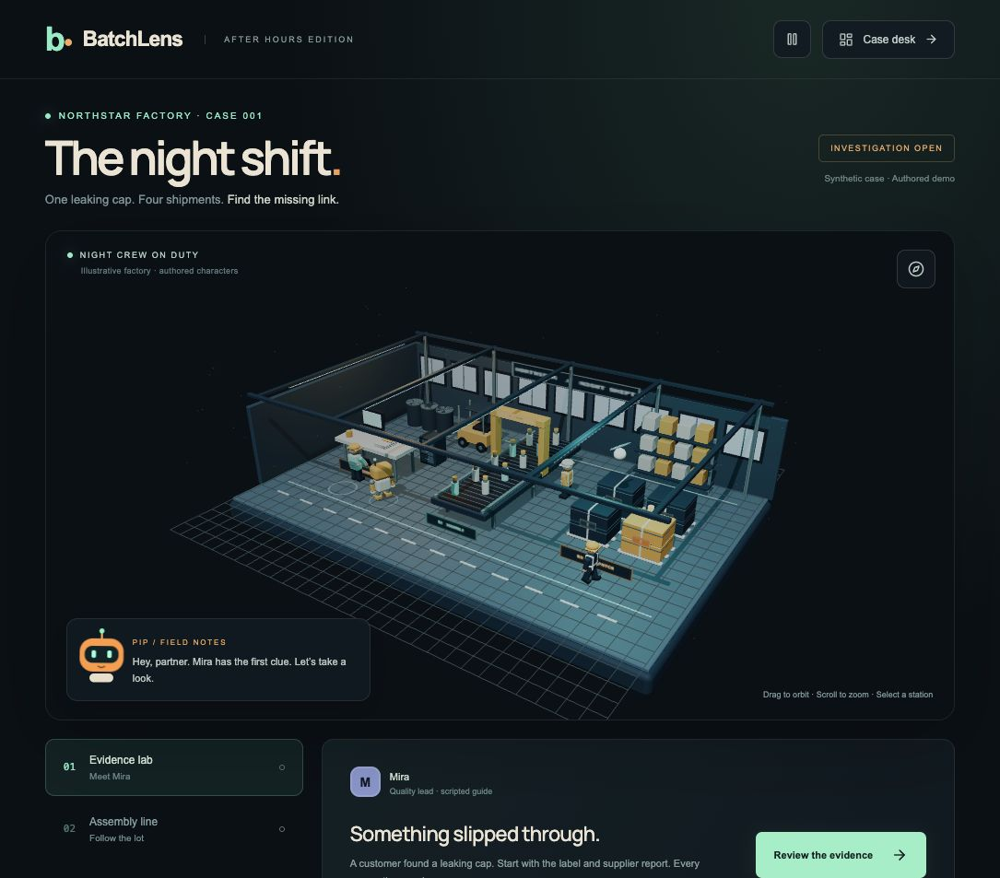
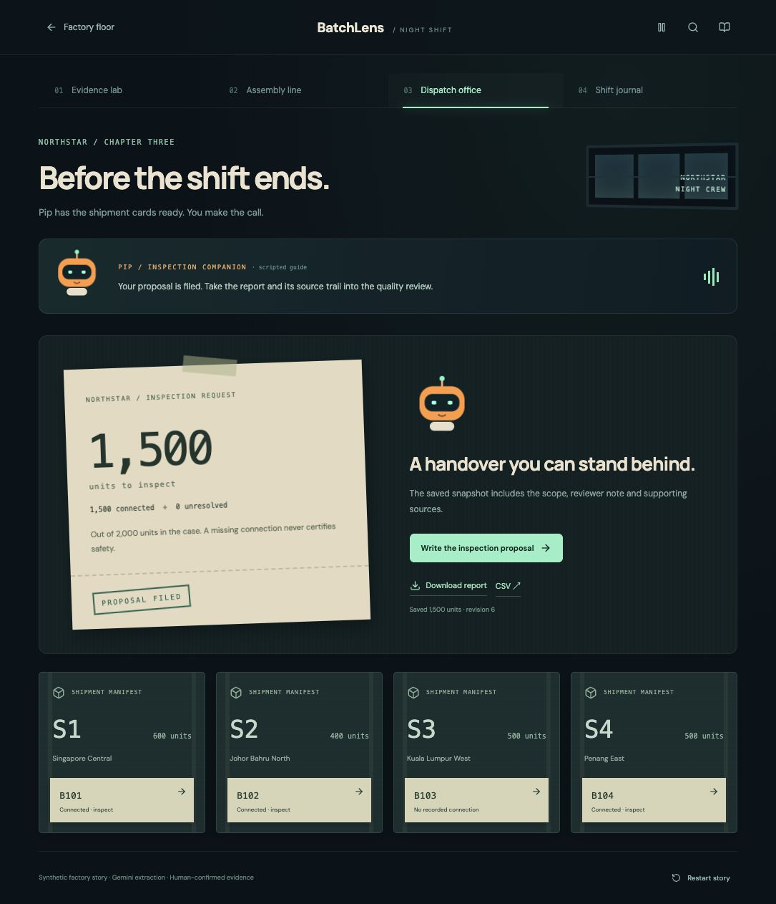
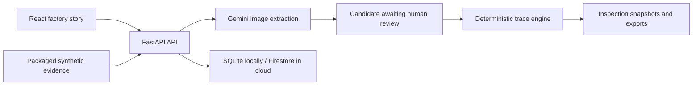

# BatchLens

**Follow the evidence. Find the affected batches. Hand over a defensible inspection plan.**

BatchLens turns a manufacturing quality investigation into an interactive factory story. Walk through Northstar’s night shift with Mira, Sol and Pip, use Gemini to read source documents, trace a component lot into shipments, and approve an inspection proposal backed by original evidence.

[Live demo](https://batchlens-hk3hxwi5na-as.a.run.app/) · [Demo script](research/BatchLens/03_User_Guide_and_Demo_Script.md) · [How it works](research/BatchLens/02_How_It_Works.md)



## Why it matters

When a quality complaint arrives, the relevant information is often scattered across product labels, supplier reports, production ledgers and shipment records. BatchLens brings those sources into one reviewable investigation. Its goal is to help a reviewer explain which shipments warrant inspection, what is still unknown, and which evidence supports each decision.

This is a hackathon prototype using an original synthetic case, not a validated production quality system. It does not establish defect causation or certify product safety.

## What is built

- An explorable Three.js factory with moving crew, conveyor, forklift and drone, plus illustrated rooms for every investigation chapter.
- Mira’s evidence workbench: original documents, Gemini extraction, source quotations, corrections and explicit reviewer confirmation.
- Sol’s assembly schematic: component-to-batch-to-shipment trace with source-linked relationships and separate unresolved quantities.
- Pip’s dispatch office: recover a missing packing slip, resolve its shipment relationship and save an inspection handover.
- Immutable proposal snapshots, downloadable HTML reports and CSV exports, a shift journal, and case persistence across refreshes.
- Motion controls, reduced-motion support, mobile room layouts and a usable case desk when WebGL is unavailable.

Characters and dialogue are authored guides. Gemini reads evidence images; it does not generate the characters’ dialogue or autonomously approve inspection decisions.

## Try the complete story

1. Select **Enter factory · Play as Pip**. Walk with WASD/arrows or the touch pad; drag to look. Follow the minimap to Mira and press **E** to enter **Mira’s evidence lab**. Scan the product label and supplier report, inspect the production and shipment ledgers, then confirm the baseline.
2. Visit **Sol’s assembly line**. Component lot `CAP-17` connects to batches `B101`, `B102` and `B104`. Shipments S1 and S2 account for 1,000 connected units; S4’s 500 units remain unresolved.
3. Resolve the evidence gap using the supplied recovered packing slip. Scan it, compare the candidate `B104` with the original, then explicitly confirm the S4 relationship.
4. Join **Pip in dispatch**. The final scope is 1,500 connected units, zero unresolved units and 500 units outside the recorded connection.
5. Add a reviewer note, save the inspection proposal, download HTML or CSV, and refresh to see the persisted handover. **Reset demo** starts a fresh case.

The conservative inspection quantity is 1,500 both before and after resolving S4. The recovered evidence improves certainty rather than artificially reducing the scope. Extraction alone never changes the trace.



## Run locally

Prerequisites: **Node.js 22+**, **Python 3.13**, and Git.

```sh
git clone https://github.com/mk-tdev/BatchLens.git
cd BatchLens
npm ci
python3.13 -m venv .venv
.venv/bin/pip install -r requirements.lock
cp .env.example .env
./scripts/dev.sh
```

Open http://127.0.0.1:5173. Vite forwards `/api` requests to FastAPI on port 8000. Stop with Ctrl+C. Local SQLite data is stored in `.data/`, which is excluded from Git.

The default local mode uses **clearly labeled authored extraction fixtures**, so teammates can run the full workflow without cloud credentials or model charges. Never commit `.env`, credentials or case data.

### Enable real Gemini locally

For Vertex AI, authenticate Application Default Credentials with `gcloud auth application-default login`, then set these values in `.env`:

```dotenv
GOOGLE_CLOUD_PROJECT=your-approved-project-id
GOOGLE_CLOUD_LOCATION=global
MODEL_ID=gemini-3.5-flash-lite
DAILY_MODEL_CALL_LIMIT=100
```

Your identity needs access to the project’s enabled Vertex AI API and model. Alternatively, set `GEMINI_API_KEY` and a `MODEL_ID` supported by that API instead of using Vertex AI credentials. Model availability depends on the provider and project. Restart the development servers after changing configuration.

The backend uses `google-genai` and structured Pydantic output. Unreadable identifiers can return null; invalid identifiers are rejected. Live failures are surfaced and never replaced silently with fixture answers. Cloud Run refuses to start in authored mode.

## Architecture



React, TypeScript and Vite power the interface; Three.js renders the factory. FastAPI owns case access, extraction, review commands and exports. A pure trace engine computes scope from confirmed relationships, counting each shipment line once. SQLite and Firestore adapters persist investigations with revision checks and request deduplication.

The bounded MVP stores one JSON document per investigation, with up to 24 review commands, three proposal snapshots and eight extraction attempts. Larger investigations need a revised storage model.

```text
frontend/             React interface, factory scene, custom artwork
backend/app/          API, Gemini adapter, trace engine, storage
backend/scenarios/    Original synthetic evidence and CSV records
scripts/              Development, evidence rendering, cleanup, live smoke check
tests/                Backend regression and Playwright browser tests
deploy/               Cloud Build and Cloud Run deployment scripts
research/BatchLens/         Project explanation, user guide, submission preparation
```

## Google Cloud deployment

The current demo runs on **Cloud Run in asia-southeast1**, with a named **Firestore database `batchlens`** and **Gemini 3.5 Flash-Lite through Vertex AI**. Runtime authentication uses a service identity, with no browser API key or downloaded service-account key.

Deployment requires an authenticated Google Cloud CLI, a billing-enabled project, and permission to configure the required APIs, IAM, build resources and service. The scripts default to the existing demo project; explicitly set your target for a separate deployment:

```sh
export BATCHLENS_PROJECT=your-approved-project-id
export BATCHLENS_REGION=asia-southeast1
export BATCHLENS_MODEL=gemini-3.5-flash-lite
bash deploy/cloudrun.sh setup
bash deploy/cloudrun.sh deploy
bash deploy/cloudrun.sh publish
```

`setup` enables APIs and provisions service identities, scoped permissions, an image repository, build bucket, named database and TTL. `deploy` builds and deploys the container. `publish` grants public invocation. These commands change cloud resources and can incur usage charges; they are not needed for local development. Do not redeploy the shared demo without coordinating with the owner.

Configured limits: minimum zero / maximum two instances, 100 model attempts per day across cases, eight attempts per case, and one concurrent extraction per case. **These are usage controls, not a monetary spending cap.** Cloud billing and credits must be managed separately. The hosted demo depends on available project credits and service access.

## Verification

```sh
.venv/bin/python -m pytest -q
npm run build
# With both local servers running:
npm run types
npx playwright install chromium
npm run test:e2e
# Optional live verification: consumes four real model calls
.venv/bin/python scripts/live_smoke.py https://YOUR-SERVICE-URL
```

Recorded on 15 October 2026: 10 backend tests and the production build passed. The hosted Gemini workflow read E2 → B101, E3 → CAP-17, unreadable E6 → null, and recovered E7 → B104. Human confirmations, final scope, HTML/CSV exports and reload passed. See [machine-readable live verification](docs/live-cloud-verification.json) and [validation history](docs/validation.md). Automated Playwright tests are provided but have not been reported as passing; browser walkthroughs were performed manually.

## Data, security and limitations

- Only the supplied synthetic scenario is supported. Arbitrary uploads and real confidential records are outside this MVP.
- Case ownership uses an HttpOnly cookie; deployed cookies use Secure and SameSite=Strict. Mutations check origin/custom headers, expected revision and duplicate requests.
- Case access expires after 24 hours. Firestore TTL performs eventual physical cleanup; local cleanup is `.venv/bin/python scripts/cleanup.py`.
- The model proposes facts; a human confirms them. The audit trail records review decisions and proposal snapshots.
- A recorded relationship supports inspection, not proof of a defect. “No recorded connection” does not mean safe.
- No measured production savings, external user pilot or real-world defect-detection performance is claimed.

## Team handoff and documentation

The repository is public for teammates and hackathon judges. Anyone can clone it and use authored local mode immediately; write access and cloud access are granted separately. Work on a feature branch and open a pull request before changing the shared demo.

- [Project overview and impact](research/BatchLens/01_Project_Overview.md)
- [Technical explanation](research/BatchLens/02_How_It_Works.md)
- [User guide and three-minute demo script](research/BatchLens/03_User_Guide_and_Demo_Script.md)
- [Submission checklist and judge Q&A](research/BatchLens/04_Submission_Checklist_and_Judge_QA.md)
- [Deployment and live verification](research/BatchLens/05_Deployment_and_Verification.md)
- [Three-minute video recording script](research/BatchLens/06_Three_Minute_Demo_Script.md)
- [Playable factory controls and template alignment](research/BatchLens/09_Playable_Factory.md)
- [All research and organizer requirements](research/BatchLens/README.md)
- [Asset provenance](docs/provenance.md)
- [Original build plan](BUILD_PLAN.md) — design intent and historical scope, not a claim that every planned feature shipped.

The logo, SVG characters, factory geometry and evidence artifacts were authored for BatchLens. The illustrative bottle photograph is AI-generated and is not used as extraction evidence. Third-party dependencies retain their respective licenses. No project license has been selected yet.
