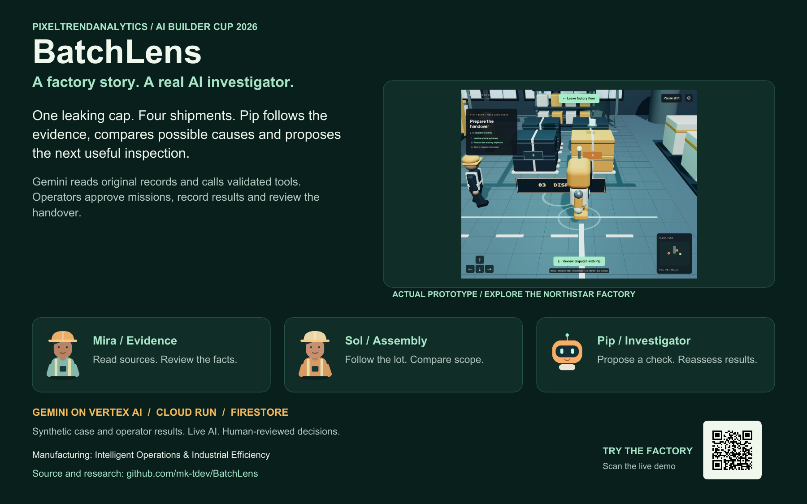
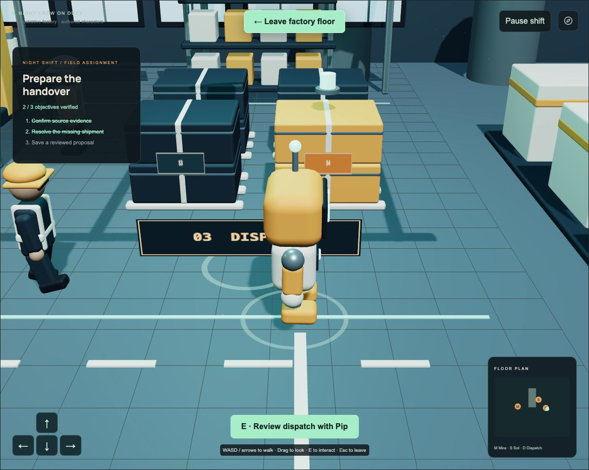
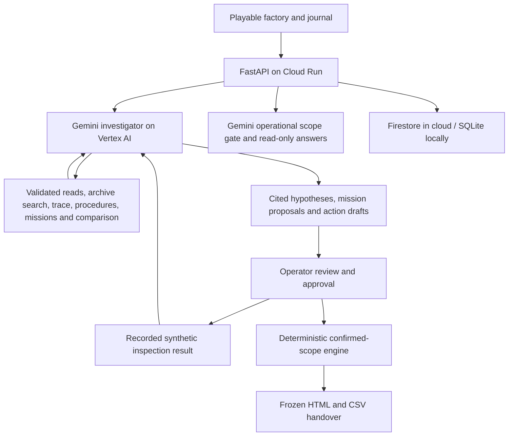

<p align="center">
  
</p>

# BatchLens · The Night Shift

**An agentic quality investigator inside a playable factory.**

One leaking cap. Four shipments. A missing batch reference. BatchLens helps a quality operator follow the evidence, compare possible causes, approve useful inspection missions and hand over a traceable plan. Pip uses **real Gemini tool calling**; the operator reviews the facts and decisions.

**AI Builder Cup 2026** · **PixelTrendAnalytics** · **Manufacturing: Intelligent Operations & Industrial Efficiency**

[**Open the live factory →**](https://batchlens-hk3hxwi5na-as.a.run.app/) · [**Pitch deck PDF**](docs/submission/BatchLens-Pitch-Deck.pdf) · [**Submission pack**](docs/submission/README.md) · [**Research**](research/BatchLens/README.md)

[](docs/submission/BatchLens-Project-Poster.pdf)

## For organizers and judges

| Submission item | Link and status |
| --- | --- |
| Working prototype | [Public Cloud Run app](https://batchlens-hk3hxwi5na-as.a.run.app/) |
| Prescribed-template pitch deck | [PDF, 14 slides, under 5 MB](docs/submission/BatchLens-Pitch-Deck.pdf) · [PowerPoint](docs/submission/BatchLens-Pitch-Review.pptx) · [Native Google Slides](https://docs.google.com/presentation/d/1_EZO4q_fb1DqmobJcNyoKLMNwv2pT2bQ2s4mr_dYXNs/edit) |
| Public source and supporting materials | [This repository](https://github.com/mk-tdev/BatchLens) · [Research index](research/BatchLens/README.md) |
| Brief solution description | [Ready-to-paste description, within the 1,024-character form limit](docs/submission/solution-description.txt) |
| Working demo video, 3–4 minutes | **Pending final recording/upload.** [Three-minute recording script](research/BatchLens/06_Three_Minute_Demo_Script.md). A script or GIF is not the required video. |
| Supporting posters | [Project overview PDF](docs/submission/BatchLens-Project-Poster.pdf) · [Agentic workflow PDF](docs/submission/BatchLens-Agentic-Workflow-Poster.pdf) |

The [submission pack](docs/submission/README.md) maps the materials to the organizer's form, including the PDF size limit, public-link checks and remaining video step. The first and last deck slides retain the organizer template; the title slide names PixelTrendAnalytics and team leader Muthukumar Arunachalam. PDF playback is static; animations remain in supported presentation playback.

## The problem and intended impact

A quality complaint rarely arrives with a complete investigation. Labels, supplier checks, production records and dispatch slips are scattered. A reviewer must distinguish a recorded connection from a proven defect, account for missing evidence, and explain why units enter the inspection scope.

BatchLens combines source reading, an auditable AI investigation and deterministic tracing in one workflow. The intended benefit is less searching and a clearer handover. A future quality-team pilot would measure review time, missed connections and decision errors; **production savings and defect-detection accuracy have not been measured**.

The current prototype uses an original synthetic Northstar Bottles case. It is an illustrative factory environment, not a live digital twin, machine controller or validated production quality system.

## What Pip actually does

| Capability | AI or tool behavior | Operator checkpoint |
| --- | --- | --- |
| Read evidence | Gemini extracts identifiers and source quotes from images; unreadable values can remain null | Inspect originals, correct or confirm candidates |
| Investigate missing links | Gemini chooses document reads, a bounded archive search and trace tools; the journal shows actual calls and results | Accept relationships explicitly |
| Compare causes | Gemini compares component defects, assembly variation and handling damage using cited evidence and missing checks | Review hypotheses; they are not root-cause verdicts |
| Propose missions | Gemini selects an allowlisted fictional procedure and proposes a check at Mira's or Sol's station | Approve the demo mission before entering results |
| Learn from results | Gemini reads immutable operator results such as R1 and reassesses its hypotheses | Enter clearly labelled synthetic observations; review the revised findings |
| Compare scope | A deterministic tool compares connected-only, connected-plus-unresolved and all-shipment workloads | Workload assumptions are illustrative; scenarios do not issue orders |
| Clarify operations | Gemini answers case-specific questions with citations; a separate scope gate refuses general or mixed requests | Chat is read-only and cannot approve decisions |
| Hand over | Gemini drafts actions with owner roles, verification needs and citations | Approve drafts, save a snapshot, export HTML/CSV |

Mira and Sol are scripted guides, and Pip's factory avatar is authored. Pip's **investigator and operational chat** use real Gemini. The server computes the visible change summary by comparing saved Gemini assessments; it is labelled computed. Neither AI nor the software performs physical inspections, releases stock or dispatches work orders.

## Experience the complete factory story

1. **Start fresh.** Open the live app, choose **Pip / AI investigator → Let Pip investigate**. Watch actual source-reading and tool activity in the factory journal.
2. **Challenge the explanation.** Open **Causes** and inspect the supporting sources, contradictions and missing evidence. Open **Scope lab** to compare the labelled workload scenarios.
3. **Approve a mission.** Open **Missions**, read fictional procedure E8, then select **Approve this demo mission**. Mission stations are also reachable from the factory floor.
4. **Review the baseline.** At Mira's workbench, inspect E2 (`B101`), E3 (`CAP-17`), production ledger E4 and shipment ledger E5. Confirm the baseline. Review recovered slip E7 and explicitly confirm S4 → `B104`.
5. **Record an operator result.** Enter sample IDs, counts, method, observations and limitations. These are **synthetic demo inputs**, not real measurements. Record all intended results before the one available follow-up investigation.
6. **Reassess.** Select **Reassess with operator results**. Look for R-source citations and assessment changes. Use **Ask Pip** to clarify the evidence; ask a general query to see the refusal.
7. **Review the handover.** Approve appropriate action drafts, prepare the inspection proposal, add a rationale, save the snapshot and export it. Reload to verify persistence.

**Walk as Pip:** WASD/arrows or the touch pad to move, drag to look, **E** near a station to enter its workflow, **Esc** to leave walking mode. The interface also offers direct room navigation, motion controls, reduced-motion support and a case desk when WebGL is unavailable.

### What the sample case establishes

`CAP-17` connects to batches `B101`, `B102` and `B104`. Before S4 is reviewed, the trace includes **1,000 connected + 500 unresolved = 1,500 units** for conservative inspection. After the recovered mapping is approved, it shows **1,500 connected + 0 unresolved**. Another 500 units have no recorded connection; that does not certify safety.

The recovered record improves certainty; it does not artificially reduce the conservative total. A live adaptive run recorded R1 as two leaking assemblies out of five fictional samples. Gemini changed the component-defect hypothesis from unresolved to supported, while assembly and handling remained unresolved. This demonstrates reassessment, not a proven root cause or lot-wide defect.

[](https://batchlens-hk3hxwi5na-as.a.run.app/)

[Mission/result screenshot](docs/submission/pip-mission-result.png) · [Operational chat screenshot](docs/submission/pip-operational-chat.png) · [Example exported handover](docs/submission/adaptive-handover-example.html)

## Why this fits the manufacturing challenge

The challenge asks for operational data to become useful insights, recommendations or actions. BatchLens focuses on **quality investigation and an operational copilot**: evidence becomes cited hypotheses, proposed checks and a reviewed inspection handover. It uses Gemini on Vertex AI for reasoning and assistance, and Cloud Run for the application. It does not claim every suggested challenge technology is implemented.

| Google service | Actual use |
| --- | --- |
| **Gemini 3.5 Flash-Lite on Vertex AI** | Image extraction, manual function-calling loop, structured findings, scope classification and cited operational answers |
| **Cloud Run** | Public React/FastAPI application and server-side AI orchestration in `asia-southeast1` |
| **Firestore** | Named `batchlens` database for cases, candidates, missions/results, review history, chat and frozen proposals |
| **Cloud Build + Artifact Registry** | Container build and image delivery to Cloud Run |
| **Cloud Storage** | Deployment source staging; case evidence is packaged with the app |
| **Firebase** | No Firebase Hosting, Authentication or client SDK is used. Firestore is accessed through its server SDK. |

## Architecture and authority



Tool results and documents are untrusted input. The tool allowlist has no approval, release or machine-control operation. Case ownership, origin checks, revision checks, request deduplication and immutable result records protect mutations. Reports and comparisons are investigation-time snapshots; later human approvals do not rewrite earlier AI observations.

The live investigator permits **two runs per case**, each with up to five tool-calling turns plus one schema-constrained report turn, 24 tool actions and 95 seconds. Cases allow eight image extraction attempts, twelve investigator calls, and six chat questions/up to twelve chat calls. All share a **100-model-attempt daily limit**. Cloud Run has zero minimum and two maximum instances. These are usage controls, not a monetary spending cap. Case access expires after 24 hours, with eventual Firestore TTL cleanup.

## Run locally

Prerequisites: **Node.js 22+**, **Python 3.13** and Git.

```sh
git clone https://github.com/mk-tdev/BatchLens.git
cd BatchLens
npm ci
python3.13 -m venv .venv
.venv/bin/pip install -r requirements.lock
cp .env.example .env
./scripts/dev.sh
```

Open `http://127.0.0.1:5173`. Vite forwards `/api` to FastAPI on port 8000. Ctrl+C stops the servers. Local SQLite data stays in ignored `.data/`.

Default local mode uses **labelled authored image-extraction fixtures** for the manual evidence-to-handover workflow. **Pip's autonomous investigator and operational chat require real Gemini**; fixture mode does not simulate them.

### Enable real Gemini

Authenticate Application Default Credentials with `gcloud auth application-default login`, then set the following in `.env`:

```dotenv
GOOGLE_CLOUD_PROJECT=your-approved-project-id
GOOGLE_CLOUD_LOCATION=global
MODEL_ID=gemini-3.5-flash-lite
DAILY_MODEL_CALL_LIMIT=100
```

The project must have Vertex AI enabled and your identity must have model access. Alternatively, set `GEMINI_API_KEY` and a model supported by that API. Restart after configuration changes. Never commit `.env` or credentials. Live failures are shown and never silently replaced with fixtures. Cloud Run refuses authored mode.

### Verify and deploy

```sh
.venv/bin/python -m pytest -q
npm run build
# Optional browser suite, with local servers running:
npx playwright install chromium
npm run test:e2e
# Optional hosted extraction smoke check; consumes four real model calls:
.venv/bin/python scripts/live_smoke.py https://YOUR-SERVICE-URL
```

**Recorded verification, 17 October 2026:** 22 backend tests and the production build passed. Manual internal-browser checks on the hosted app covered real Gemini investigation, mission approval, R1 entry, reassessment, baseline/S4 review, action approval, export and saved-case reload. Operational chat answered a cited case question and refused an off-topic override. The browser automation suite is provided but is not claimed as passing. See [adaptive verification](research/BatchLens/11_Adaptive_Operations.md) and [deployment record](research/BatchLens/05_Deployment_and_Verification.md).

For your own deployment, review [the deployment guide](research/BatchLens/05_Deployment_and_Verification.md) and `deploy/cloudrun.sh`. Explicitly set `BATCHLENS_PROJECT`, `BATCHLENS_REGION` and `BATCHLENS_MODEL`. The script's `setup`, `deploy` and `publish` stages provision billable cloud resources and permissions. Coordinate with the owner before changing the shared demo.

## Source map and research

```text
frontend/           React, TypeScript, Three.js factory, custom components and art
backend/app/        API, Gemini investigator/chat, deterministic tracing and storage
backend/scenarios/  Original synthetic evidence and operational records
tests/              Backend regressions and browser test definitions
deploy/             Cloud Build and Cloud Run configuration
scripts/            Local development, evidence rendering and verification tools
docs/submission/    PDF/PPTX deck, posters, description, screenshots and handover
research/BatchLens/ Project explanation, architecture, guides and judge Q&A
```

- [Project overview](research/BatchLens/01_Project_Overview.md) · [How it works](research/BatchLens/02_How_It_Works.md)
- [Adaptive AI and operations guide](research/BatchLens/11_Adaptive_Operations.md) · [Investigator controls](research/BatchLens/10_AI_Quality_Investigator.md)
- [Submission checklist and judge Q&A](research/BatchLens/04_Submission_Checklist_and_Judge_QA.md)
- [Three-minute recording script](research/BatchLens/06_Three_Minute_Demo_Script.md) · [Playable factory](research/BatchLens/09_Playable_Factory.md)
- [All research](research/BatchLens/README.md) · [Asset provenance](docs/provenance.md) · [Original build plan](BUILD_PLAN.md)

## Boundaries, team and attribution

Only the supplied synthetic scenario and fictional inspection procedures are supported. General uploads, enterprise authentication, ERP integration and real machine control are future work. Semantic chat filtering is model-based; hard code-level boundaries prevent chat from changing decisions. No production accuracy, industrial certification, physical tests performed by AI or measured savings are claimed.

**Team:** PixelTrendAnalytics · **Team leader:** Muthukumar Arunachalam · **Public source:** [mk-tdev/BatchLens](https://github.com/mk-tdev/BatchLens).

The mark, crew artwork, factory geometry and evidence records were authored for BatchLens. Screenshots show the working prototype. The illustrative bottle photo and cinematic artwork are AI-generated and are not extraction evidence. Dependencies retain their licenses; a project-wide license has not yet been selected. See [asset provenance](docs/provenance.md).
