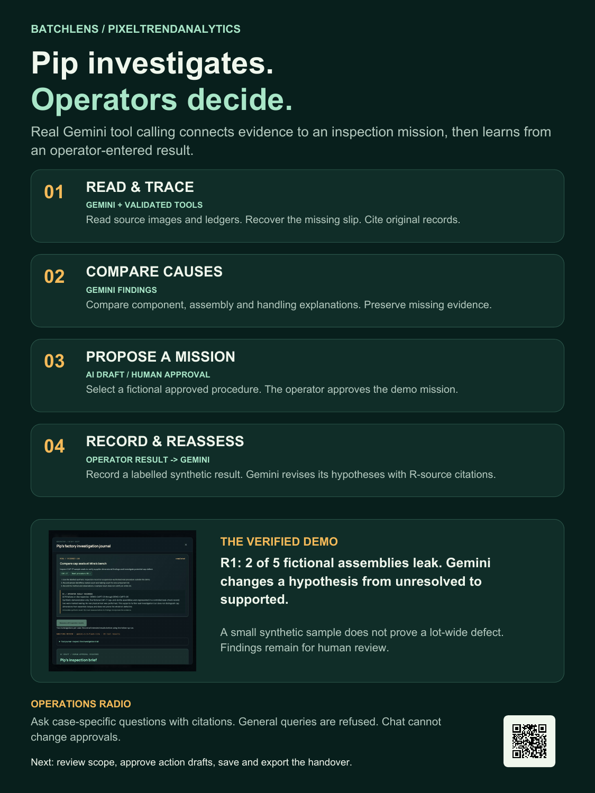

# BatchLens submission pack

**Team:** PixelTrendAnalytics
**Team leader:** Muthukumar Arunachalam
**Track:** Manufacturing: Intelligent Operations & Industrial Efficiency

This folder packages the public supporting materials for AI Builder Cup 2026. It does not indicate that the organizer's submission form has been submitted.

## Required form fields

Checked against the [prototype submission form](https://hack2skill.com/event/aibuildercup2026/dashboard/submissions/6a5da99a444e4f43e5657a85) in the internal browser on 17 October 2026.

| Form field | Material to use | Status |
| --- | --- | --- |
| Challenges | Manufacturing: Intelligent Operations & Industrial Efficiency | Selected project track |
| Prototype deployed on GCP/Cloud Run | https://batchlens-hk3hxwi5na-as.a.run.app/ | Deployed public prototype |
| Final prototype deck converted into PDF | [BatchLens-Pitch-Deck.pdf](BatchLens-Pitch-Deck.pdf) | 14 slides, approximately 0.53 MiB; form accepts PDF up to 5 MB |
| GitHub repository, public access | https://github.com/mk-tdev/BatchLens | Public source and research |
| Demo video link, 3–4 minutes | Final recording/upload URL | **Pending.** [Recording script](../../research/BatchLens/06_Three_Minute_Demo_Script.md) is preparation, not a video |
| Brief description including Google services | [Copy this text](solution-description.txt) | Within the form's 1,024-character limit |

The live prototype and public materials must remain available throughout evaluation. The form requires a working video demonstration; a script, poster, GIF or slideshow does not replace it. Check the portal for the current deadline and any organizer changes before submitting.

## Deck and visuals

Latest exports: **18 October 2026**. The cost slide includes the measured Gemini token usage and the estimated total monthly cloud budgets for 100 and 1,000 cases. Infrastructure estimates and pricing sources appear in the PowerPoint speaker notes.

- [PDF pitch deck](BatchLens-Pitch-Deck.pdf) — static export of the reviewed native deck; first and last organizer-template slides retained.
- [Editable PowerPoint export](BatchLens-Pitch-Review.pptx).
- [Native Google Slides](https://docs.google.com/presentation/d/1_EZO4q_fb1DqmobJcNyoKLMNwv2pT2bQ2s4mr_dYXNs/edit) — access depends on its Drive sharing; use the repository PDF for public review.
- [Project poster PDF](BatchLens-Project-Poster.pdf) · [PNG](BatchLens-Project-Poster.png).
- [Agentic investigation poster PDF](BatchLens-Agentic-Workflow-Poster.pdf) · [PNG](BatchLens-Agentic-Workflow-Poster.png).
- [All-slide preview](pitch-preview.png).

The posters use original vector layout, original crew assets and actual prototype screenshots. They are supporting materials, not substitutes for the prescribed deck. Regenerate their PDFs with `scripts/create_submission_posters.py` using the optional authoring dependency `reportlab`; generate PNG previews with Poppler. PDF exports are static.

## Evidence of the working prototype

- [Walkable factory](live-walkable-factory.png)
- [Real investigator journal](pip-investigator-live.png)
- [Approved mission and immutable R1 result](pip-mission-result.png)
- [Operational Gemini answer](pip-operational-chat.png)
- [Example exported handover](adaptive-handover-example.html)
- [Detailed adaptive verification](../../research/BatchLens/11_Adaptive_Operations.md)
- [Deployment and original live extraction record](../../research/BatchLens/05_Deployment_and_Verification.md)

These are synthetic demonstration records. The operator-entered seal-check result is not a real physical measurement. The app uses live Gemini, while scope arithmetic and assessment-history comparison are deterministic server operations. No production accuracy or savings claim is supported by this demo.

## Before final submission

1. Record and publish a **3–4 minute** video showing real Gemini, source review, mission approval, a labelled synthetic operator result, reassessment and saved handover. Disclose any shortened processing waits.
2. Test the video link and GitHub/PDF access while signed out. Add the actual video URL to the deck, repository and submission form when available.
3. Open the deployed app and check a real inference, not only the health endpoint. Keep model budget, APIs and hosting available through evaluation.
4. Upload the prescribed-template PDF, paste the public URLs and description, and review the form. Final submission is a separate action.
