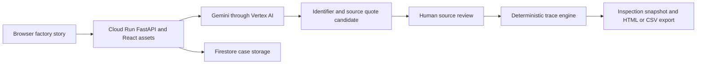

# How BatchLens works

BatchLens combines visual document extraction, explicit human review and deterministic traceability. The factory story presents these steps as rooms, while the backend records the same evidence and decisions in an investigation.

## Architecture

The frontend uses React, TypeScript and custom CSS. Three.js renders the original factory and animated characters. FastAPI serves the compiled app and same-origin API in one container. Google’s Gen AI SDK sends source images to Gemini using the Cloud Run service identity. Firestore stores cases, extraction jobs, review history and proposal snapshots. SQLite is used for local development only.

## Source evidence

| ID | Record | Role |
| --- | --- | --- |
| E1 | Customer complaint | Explains the reported leaking cap |
| E2 | Product label image | Gemini reads the finished batch identifier |
| E3 | Supplier inspection image | Gemini reads the component lot with an out-of-tolerance result |
| E4 | Production CSV | Maps finished batches to component lots |
| E5 | Shipment CSV | Maps outbound units to finished batches |
| E6 | Obscured packing slip | Demonstrates uncertainty; an unreadable identifier should remain null |
| E7 | Recovered packing slip | Gemini reads S4’s finished batch; reviewer confirms the connection |

## What Gemini does

For each extraction, the server sends one selected PNG and a focused instruction. It asks for a batch or lot identifier, a short source quote, and null when unreadable or ambiguous. Documents are treated as data rather than instructions. A structured response schema bounds the output, and identifier validation rejects values outside this case’s schema.

A valid response is stored as a pending candidate with provider, model, quote and inference metadata. It never directly changes the graph. The reviewer can inspect, reject or correct a candidate; a correction requires a reason. API failures surface as errors without silently substituting authored answers. Cloud Run refuses to start without live model configuration.

Quotes are model-produced excerpts for human comparison with the displayed original, not independently verified OCR. A valid JSON response is not proof of correctness.

## What remains deterministic

The production and shipment CSV files provide the underlying relationships. Once the baseline is confirmed, the trace engine classifies each shipment:

- **Connected:** its finished batch uses the selected suspect component lot.
- **Unresolved:** its batch identifier is unconfirmed or unknown.
- **No recorded connection:** its recorded batch uses another lot in this case.

Inspection scope equals connected units plus unresolved units. Gemini does not perform the final scope arithmetic. Changing the suspect-lot hypothesis requires a recorded reason and recomputes the trace.

## State and review controls

Each investigation belongs to a browser via an HTTP-only ownership cookie and expires after 24 hours. Cloud Run uses a secure cookie. API commands carry a revision and request ID to detect stale views and deduplicate repeated submissions. Firestore mutations are transactional. Extraction jobs use a lease, and each case allows eight image scans and twelve investigator model calls, 24 command requests and three proposal snapshots. A shared daily model-call ceiling bounds live inference usage.

A saved proposal freezes the reviewed scope, candidate excerpts, source manifest and reviewer note. Later changes do not rewrite the previous proposal. HTML and CSV downloads remain associated with the owning case. Expiry prevents access; Firestore TTL cleanup is a separate deployment setting and is not instantaneous.

## Why the factory theme matters

Mira’s animated workbench explains how to read and review evidence. Sol’s line schematic exposes the component-to-batch-to-shipment path. Pip’s dispatch office turns the result into a handover. Shared pause and reduced-motion support keep the interface usable without animation. The world is illustrative and its crew is scripted; neither represents autonomous industrial control.

## Technical references

- [Cloud Run source deployment](https://docs.cloud.google.com/run/docs/deploying-source-code)
- [Gemini model lifecycle](https://docs.cloud.google.com/gemini-enterprise-agent-platform/models/model-versions)
- [Firestore database administration](https://docs.cloud.google.com/firestore/native/docs/manage-databases)

Exact deployed project, model, URL and verification evidence belong in `05_Deployment_and_Verification.md`.
